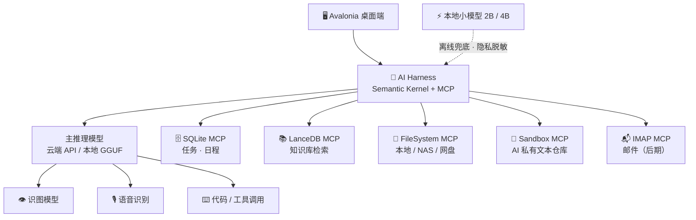

<h1>CogniCustos</h1>

<b>知识管理者 · 本地优先的个人 AI 学习助手</b>

让 AI 全知，让用户全能。

Local-first · Private · Offline-ready · Multimodal

  
  
  
  
  
  
  

---

## 💡 项目简介

**CogniCustos**（*Cognition* × *Custos*，认知的守护者）是一个**本地优先的个人 AI 学习助手**。它把「数据库 + 知识库 + AI Harness（模型编排与工具调用框架）」组合成一个整体：任务与日程落在 SQLite，资料与笔记沉淀为可检索的 LanceDB 知识库，AI 通过 MCP 工具层在两者之间自由流转。

- **无服务器、无登录**：所有数据（数据库、知识库、邮件缓存）只留在本地设备；
- **模型与数据源可配置**：云端 API、本地量化模型、NAS、网盘、邮件与社交消息，按需接驳；
- **不只是回答**：AI 会主动标注、总结、产出，并把结果直接写回数据库与知识库。

它面向**大学生、研究生与自学者**，源于一个很具体的处境：课程多、DDL 密集、资料散落，自学又缺少方向。目标也很明确——做一个高度集成、深度本地、主动省时、低使用成本的学习助手。

## ✨ 核心特性

- 🔒 **本地优先，配置自由** — 数据隔离在设备本地，无服务器、无登录；云端 API、本地模型、NAS、网盘与邮件 / 社交消息都按需接驳。内置小模型还可以作为隐私守门人，先对敏感内容过滤或脱敏，再决定是否外发。
- 🗂 **数据库 × 知识库 × AI 三位一体** — 结构化数据与语义检索各司其职，AI 在同一上下文中完成查询、整理、写入与调用。
- 📥 **AI 主动落库** — 不必先问“要不要产出”：日程规划、学习方案、课程准备、学术工具、项目指导等产出会直接写进数据库 / 知识库——用户要用时调用，不用时就是 AI 自己的上下文。
- 📬 **主动式信息管家** — 读取邮件与社交消息，联网检索学校官网（课表、校历、教授信息），主动生成通知、提醒与日程草稿；邮件只做总结、标注、筛选和分类，删除与否始终由用户决定。
- 🧩 **MCP 工具层** — 数据库、知识库、文件系统、沙箱、邮箱都以 MCP Server 形式接入，能力可插拔、权限可审计。
- 📖 **自带说明书的 AI** — AI 可以只读地查看项目全部代码与内置文档，清楚自己能做什么、怎么用，因此也能反过来教会用户使用。
- ⚡ **小模型兜底，省 token** — 内置 2B（移动端）/ 4B（PC）量化模型：断网时可应急对话，日常处理大量简单文本；复杂任务再交给云端或更大的本地模型。
- 🎨 **多模态统一调度** — 识图与语音先转成结构化输入，再由主推理模型判断任务类型，分派给图像、声音、代码等能力。

### 🧪 设计亮点：AI 私有沙箱

这是项目最核心的差异化设计：AI 拥有一个**专属文本沙箱仓库**，可以在任何时间写任何内容，但**不能执行脚本**。

- **写给自己看**：默认不为人类阅读做适配，用于自我分析、总结、研究，甚至可选的人格建模；
- **先草稿、后确认**：需要修改主数据库的操作（如更新日程）先落在沙箱，用户确认后才生效；
- **主动标注幻觉**：AI 清楚自己在这一区域可能产生幻觉，并会标注哪些内容属于推测；
- **可读可改，但不是命令**：用户随时可以查看和编辑；用户反馈会被理解为“工作指导”，用于对冲过拟合，而不是直接问责。

> **场景示例**：「帮我整理这周 DDL。」
>
> AI 查询 SQLite 任务表与本地知识库 → 生成计划并写入沙箱 → 你确认后写入主日程；全程数据不出本地。

## 🏗️ 架构总览

四层解耦：**交互**（Avalonia）→ **编排**（Semantic Kernel + MCP）→ **模型**（云端 / 本地）→ **数据**（SQLite + LanceDB）。所有模型均可配置，读写权限彼此独立——这也是“令 AI 全知，令用户全能”得以成立的架构基础。

## 🛠️ 技术栈

| 层 | 选型 | 说明 |
| :--- | :--- | :--- |
| UI | Avalonia 11.x | 跨平台桌面，轻量、.NET 生态 |
| 本地模型 | LLamaSharp + GGUF | 2B–4B 量化模型（Qwen2.5 / Llama 3.2 / Phi-3 mini），CPU / GPU 可推理 |
| 多模态 | qwen3-ASR 0.6B · 识图模型 | 语音转写与图片理解，统一交给主推理模型调度 |
| 数据层 | SQLite 3 | 结构化任务、日程与产出，零配置本地存储 |
| 知识库 | LanceDB | 嵌入式向量检索，无需独立服务 |
| AI 编排 | Semantic Kernel + MCP | 工具调用、权限隔离、可插拔 MCP Server |
| 集成 | Ultimate IMAP MCP | 邮件读取与分类（后期阶段） |

## 🔐 权限与隐私边界

| 区域 | AI 读 | AI 写 | 用户读 | 用户写 | 说明 |
| :--- | :---: | :---: | :---: | :---: | :--- |
| 主数据库 | ✅ | 🟡 需确认 | ✅ | ✅ | 任务 / 日程 |
| 知识库 | ✅ | ❌ | ✅ | ✅ | 只读检索 |
| AI 沙箱 | ✅ | ✅ | ✅ | ✅ | AI 可写，标注幻觉 |
| 文件系统 | ✅ | ❌ | ✅ | ✅ | 本地 / NAS / 网盘只读 |
| 程序代码 / 文档 | ✅ | ❌ | ✅ | ✅ | AI 只读，用于自我解释与教学 |
| 邮件（后期） | ✅ | ❌ | ✅ | ✅ | 总结 · 标注 · 分类 |

> **只读权限近乎无限，写入权限严格受限且彼此解耦——令 AI 全知，令用户全能。**

## 🗺️ 路线图

- [x] **需求与架构设计** — 场景调研、功能架构、MCP 权限模型
- [ ] **Phase 1 · 核心骨架** — Avalonia UI + Semantic Kernel + LLamaSharp + SQLite，跑通「对话 + 本地知识库检索」
- [ ] **Phase 2 · MCP 工具层** — 封装数据库、知识库、文件系统等本地能力，让 Agent 通过 MCP 调用
- [ ] **Phase 3 · 多模态** — 集成 FasterWhisper.NET / qwen3-ASR 语音识别与图片识别
- [ ] **Phase 4 · 主动能力** — Ultimate IMAP MCP 邮件管理，联网检索学校信息
- [ ] **Phase 5 · 移动端** — 编译 Android 原生库，适配移动端性能与交互

<b>🔭 更远的探索</b>

- 🎼 AI 扒谱，辅助音乐学习
- 🎨 提炼图片风格，辅助艺术学习
- 📄 PDF / PPT 定位讲解：点到哪里讲哪里，而不是从头到尾平铺直叙
- 🌐 OCR 识别 + 覆盖式翻译
- 📖 电子书翻译与注释
- ✍️ 数位板手绘笔记兼容
- 🧱 文本资源化，而非硬编码

## 🆚 与同类工具对比

| 能力 | Obsidian | NotebookLM | 通用 AI Agent | **CogniCustos** |
| :--- | :---: | :---: | :---: | :---: |
| 本地存储 | ✅ | ❌ | ❌ | ✅ |
| 无需登录 | ✅ | ❌ | ❌ | ✅ |
| AI 对话 | 插件 | ✅ | ✅ | ✅ |
| 本地模型 | ❌ | ❌ | ❌ | ✅ |
| 知识库 | ✅ | ✅ | 🟡 有限 | ✅ |
| 主动提醒 | ❌ | ❌ | 🟡 有限 | ✅ |
| 隐私 | 高 | 低 | 低 | 高 |
| 成本 | 免费 / 插件 | 免费 / 订阅 | 订阅 | 低 |

## 📦 MVP 范围

<b>做什么 / 暂不做什么（点击展开）</b>

| 模块 | MVP 包含 | 后续规划（Future Work） |
| :--- | :--- | :--- |
| UI | Avalonia 桌面端 | Android 适配 |
| 本地模型 | LLamaSharp + GGUF，2B / 4B 量化 | 多模型自动切换 |
| 数据库 / 知识库 | SQLite + LanceDB | 云同步、多模态知识库 |
| AI 编排 | Semantic Kernel + MCP 基础 | 复杂多 Agent |
| 工具层 | 文件系统、SQLite、LanceDB 三个 MCP Server | 邮件、社交、NAS、云盘 |
| 多模态 | 可选：语音转文字 | 图像识别、音乐扒谱、艺术风格提取 |
| 主动能力 | 本地日程提醒 | 邮件 / 社交读取、自动排程 |
| 隐私 | 全本地存储，云端 API 可选 | 本地模型隐私网关完整实现 |

## 📈 评估与验收

- **功能完成度**：MVP 功能通过率
- **性能**：本地模型首 token 延迟、知识库检索响应时间
- **可用性**：SUS 问卷、任务完成时间
- **隐私**：所有数据是否确实存储于本地
- **用户反馈**：邀请 10 名大学生参与可用性测试与访谈

<b>🧪 MVP 验收测试用例（示例）</b>

- 用户输入任务，AI 正确分类并写入 SQLite
- 知识库检索返回相关文档
- AI 沙箱的写入不会污染主数据库
- 无网络时，本地模型仍可对话
- 调用云端 API 前，本地模型完成脱敏检测

## 🚀 快速开始

> 🚧 **项目处于早期设计 / MVP 开发阶段，暂无可运行版本。**
>
> 首个可运行 MVP 会优先发布在 [Releases](../../releases)；届时本 README 会补上完整的环境要求与构建步骤。

规划中的运行环境：

- Windows / macOS / Linux（.NET + Avalonia 11.x）
- 4 GB 以上内存即可运行本地小模型，可选 GPU 加速
- Android 端将在 Phase 5 适配

**参与与交流**

- 有想法或使用场景？欢迎开 [Issue](../../issues) 讨论
- 想一起实现？欢迎提交 [Pull Request](../../pulls)
- 如果这个方向对你有启发，点个 ⭐ Star 关注进展

## 📚 参考方向

<b>设计与文献参考</b>（持续补充）

- SDG 4 优质教育报告
- 大学生时间管理 / 学业压力研究
- 本地 AI / 边缘推理
- MCP 协议文档、Semantic Kernel 文档
- LanceDB / 向量数据库
- 隐私计算与本地优先架构

正式版将补充更多可引用的论文与规范。

---

<b>CogniCustos</b> · Cognition × Custos · 认知的守护者 
对齐 <b>SDG 4 优质教育</b> · MySTIE（AI · 数字技术 · 教育）· Madani（创新 · 可持续 · 信任 · 关怀） 
项目处于早期阶段，欢迎 Issue / Discussion / PR · License 待定

